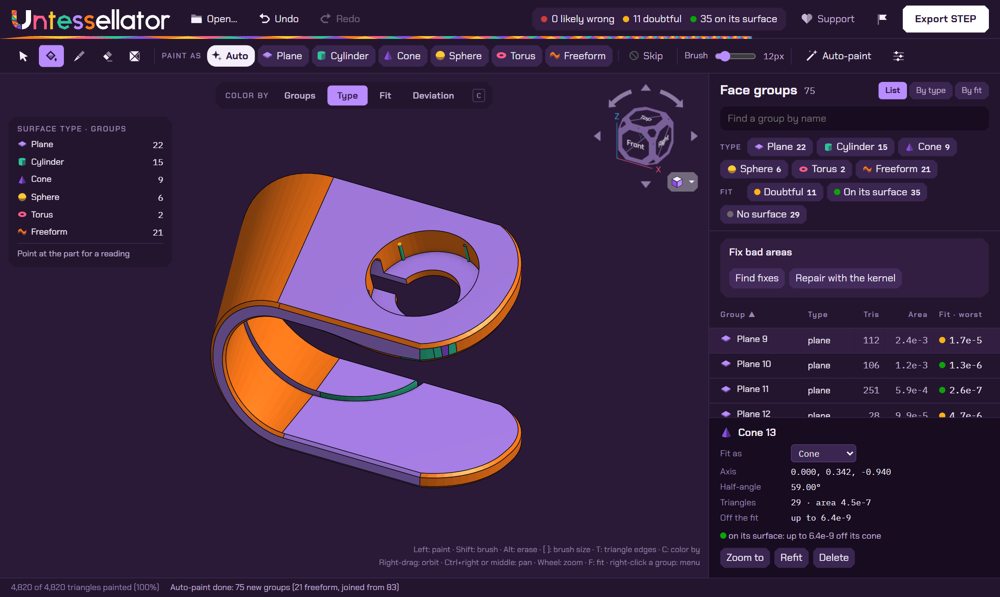

<p align="center">
  <a href="https://untessellator.com"></a>
</p>

<p align="center">
  <a href="https://untessellator.com"></a>
  <a href="https://h0witzer.github.io/Untessellator-Gallery/"></a>
  <a href="LICENSE"></a>
  <a href="https://ko-fi.com/derekvanallen"></a>
</p>

Untessellator reads an STL, OBJ or 3MF file and writes a STEP solid made of real faces:

- exact planes, cylinders, cones, spheres and tori
- B-splines only where nothing simpler fits

Open the result in any CAD program and you can select a hole, measure a diameter, or push a face.

<p align="center">
  
</p>

It runs in your browser: nothing is uploaded, there's no per-conversion fee, and it's MIT.

**Try it: <https://untessellator.com>**

**See what it recovers: <https://h0witzer.github.io/Untessellator-Gallery/>**. Every part in the gallery
was checked face by face against its original CAD file: the same faces, of the same types, each within 1 µm.

**Support it: <https://ko-fi.com/derekvanallen>**. Untessellator is free to use. If it saves you time, a tip
on Ko-fi helps keep the work going.

Untessellator was called stlToStep until October 2026. Links to the old repository redirect here.

Inspired by [CNCKitchen's stlTexturizer](https://github.com/CNCKitchen/stlTexturizer), which this
project began as a fork of.

## Why

Most parts on the internet were designed in CAD, then flattened into triangles to be printed or
shared. A typical "STL to STEP" converter wraps those triangles in a STEP file, and you get
thousands of flat faces you can't edit. The real job is recovering the surfaces the part was
designed with.

Commercial tools now sell that job by the credit. We think it should be a free capability that
works no matter what engineering software you use.

## Where it runs

There's one engine with several front ends:

| Front end | Status |
|---|---|
| **Standalone web app** (`index.html`) | Live at [untessellator.com](https://untessellator.com), served by GitHub Pages straight from `main` and tied to no CAD system. It's static files plus libraries from public CDNs, so any static host can serve it. |
| **Command line** (`test/studioExport.mjs`) | Works today. It runs Untessellator's own code and default settings headless. |
| **SolidCraft plugin** | Wanted. SolidCraft's WebAssembly plugin interface is still being designed ([tangency-labs/solidcraft#1221](https://github.com/tangency-labs/solidcraft/issues/1221)). Until it lands, SolidCraft opens our STEP files with its own reader. |
| **Onshape app** | In progress. Untessellator's viewport handles like Onshape's (camera, view cube and lighting from the vendored Form Studio kit), but the integration with Onshape itself isn't built yet. |

## Quick start

```sh
git clone https://github.com/h0witzer/Untessellator && cd Untessellator
node server.js
```

Open <http://localhost:3000> in Chrome or Edge (`npm start` does the same as `node server.js`). The
page has to be served; opening `index.html` directly from disk leaves it blank.

1. Drop an `.stl`, `.obj` or `.3mf` file onto the viewport, or press **Open…**.
2. Press **Auto-paint** (or <kbd>P</kbd>). Every unpainted face gets a face group with a surface type
   and a fit; groups you painted are left alone. <kbd>Esc</kbd> stops it.
3. See what's wrong. **Color by** over the viewport (<kbd>C</kbd> steps through it) shows each group
   in its own color, by surface type, by **Fit** (will it come out right?) or by **Deviation** (a heat
   map of where the mesh lies off its group's surface). The summary in the top bar lists the groups
   that need a look, worst first, in the face-group table.
4. Fix it. In **Fix bad areas**, **Find fixes** proposes re-fills (triangles off their group's surface
   that lie on a neighbor's), merges (neighbors one surface fits) and skips (stray shells); apply
   them as one undo step. Or fix by hand:

   | Input | Action |
   |---|---|
   | Left-drag | Fill, as the surface chosen under **Paint as** (<kbd>1</kbd>–<kbd>8</kbd>) |
   | <kbd>Alt</kbd> + drag | Erase |
   | <kbd>Shift</kbd> + drag | Paint triangles directly |
   | **Select** (<kbd>V</kbd>), or a row of the table | Select a group; right-click one for its menu |
   | Right-drag | Orbit |
   | Middle-drag, or <kbd>Ctrl</kbd> + right-drag | Pan |
   | <kbd>T</kbd> | Show every triangle edge |

   Paint geometry the import mangled as **Skip**: it is left out of fitting and the checks, and the
   export heals it over with the group around it, or drops it if nothing painted borders it.

   If the mesh still has problems after the import's repair, the summary in the top bar says so first
   ("1 hole · 16 overlapping pieces"), and **Fix bad areas** lists the mesh fixes before the groups' own:
   close holes (and take off fins and walls stuck to the surface), join pieces that cut through each other
   into one solid, remove small loose pieces. Click a fix's name to see where; **Apply** does the ticked
   ones as one undo step, and your groups come through. **Delete** (<kbd>D</kbd>) brushes triangles out of
   the mesh by hand.
5. Press **Export STEP**. The solid it builds appears over the mesh, so you can turn it and check it before
   you save; drag the shutter across the view to compare the mesh, on the left, with the STEP, on the right.
   A card says what you got. If it's a fully analytic solid, press **Save STEP**.
   If not, the card lists the groups that failed and why, and offers **Repair automatically**, fixing them
   by hand, or saving the file with those areas as flat facets.

The first export downloads the OpenCASCADE WebAssembly build. It's large, and the browser caches it
afterwards.

**Without a browser:**

```sh
npm install
node test/studioExport.mjs out/ part.stl     # writes out/part.step and out/part.json
```

## How it works

```
mesh ─► repair ─► paint face groups ─► fit + type each group ─► make relations exact ─► knit ─► STEP
```

1. **Repair.** Fix the defects that stop a solid from closing: holes, duplicate triangles, flipped
   triangles, unwelded vertices.
2. **Paint.** Split the mesh into one group per true face. This is the hard part. Small learned
   models help choose which triangles belong together, but they never decide a surface, and the
   pipeline is designed to work without them.
3. **Fit and type.** Give each group the simplest surface that holds every vertex: plane, cylinder,
   cone, sphere or torus. A B-spline is used only where none of those fits.
4. **Make relations exact.** Shared axes, tangency, equal radii and mirror symmetry become exact.
   Values are never rounded to nice numbers.
5. **Knit.** Take the topology from the mesh and the geometry from the fits. A geometry kernel
   checks the result. The export never changes your groups: the ones the kernel rejects are marked ⚠
   in the face-group table, and **Repair with the kernel** (offered after such an export, and in Fix
   bad areas) tries other surface types and merges on them in view, each kept change an undo step.
   Regions that still can't be built fall back to facets, so the export still closes.

## What to expect

- **Best on meshes exported from CAD,** where every vertex lies on the true surface: your own
  exports, and most functional parts from Printables, MakerWorld or Thingiverse.
- **Scans, sculpts and decimated meshes** give mostly B-spline and faceted faces. Scan-to-CAD is a
  long-term goal.
- **Many exports still fall back to facets.** Dense exports from CAD systems usually come out fully
  analytic. Coarser meshes often don't, and a part can come out as a valid closed solid with every
  face a facet. The export report says which you got.
- **You get faces, not a feature history.** There are no sketches or timeline yet.
- **Large meshes are slow.** Parts with tens of thousands of triangles can take minutes to paint and
  export.

## Tell us how it did

The trained models ship with Untessellator and run in your browser, so we only learn how they do on
real parts if you tell us. After a conversion, press the **flag** button next to Export STEP and
choose what goes in. It does two things:

1. **Downloads a report file** (`Untessellator-report-….zip`). It records every face group:
   - where the group is and how big it is
   - how it was made: the auto-paint seed, what the model predicted and how confident it was, and
     what decided its final type
   - how well its surface fits
   - what the export check flagged
   - what the export did with it: the kernel's verdict on that face and whether it went out as
     facets, and what Repair changed

   It also holds the groups and surfaces exactly as the export received them. A picture of the view
   and the mesh go in only if you choose them; with the mesh, we can rebuild your export exactly.
2. **Opens a GitHub issue** with a summary already filled in. Drag the report file into it, say what
   went wrong, and submit.

Nothing is sent until you press Submit, and good results help as much as bad ones. The report file
describes your part's faces (their positions, axes and radii) even without the mesh, so only attach
it where you're comfortable sharing that.

## How good is it?

We measure instead of claiming. The test sets are:

- held-out parts from the [ABC dataset](https://deep-geometry.github.io/abc-dataset/), each meshed
  four ways (OpenCASCADE, gmsh, NURBS sampling and a game-style mesher)
- 300 real Onshape exports

Each part is scored against its true CAD surfaces and rebuilt solid. Every experiment is written up,
dated and with its numbers, in [docs/ml-experiment-scope.md](docs/ml-experiment-scope.md). A public
head-to-head against other converters is next.

## Contributing

There's plenty to do: a SolidCraft plugin, a deployable standalone build, exact edges from
solidcore's intersection crate, faster fitters, feature recognition. Start with
[CONTRIBUTING.md](CONTRIBUTING.md). It covers setup, the code layout, the rules, how a change is
measured, and a ranked list of where help is needed.
Then open an issue saying what you're picking up.

## Dependencies

| Library | Version | License | Used for |
|---|---|---|---|
| [three.js](https://threejs.org/) | 0.170.0 | MIT | Mesh loaders |
| [fflate](https://github.com/101arrowz/fflate) | 0.8.2 | MIT | Reading 3MF archives |
| [onnxruntime-web](https://onnxruntime.ai/) | 1.22.0 | MIT | Running the optional models |
| [opencascade.js](https://github.com/donalffons/opencascade.js) | 2.0.0-beta | LGPL-2.1 | The geometry kernel behind the STEP export |
| Form Studio UI kit (`vendor/form-studio-ui/`) | vendored | LGPL-2.1-or-later | Untessellator's camera, view cube, menus, tooltips and rendering pieces |

The browser loads the libraries from jsDelivr and unpkg. The Node harnesses use `onnxruntime-node`
and `opencascade.js` from `npm install`.

## License

MIT; see [LICENSE](LICENSE). The file loader (`js/stlLoader.js`) still carries code from
stlTexturizer, so its copyright notice stays in LICENSE alongside ours. The two LGPL components
above keep their own licenses.
